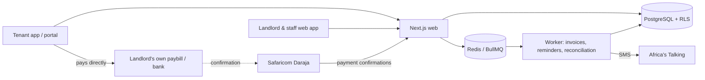

<div align="center">

# Kodibox

**Rent and property management for Kenya: collect rent straight into the landlord's own M-Pesa paybill or bank account, reconcile it automatically, and give tenants a self-service app.**

[](https://github.com/msyoki/kodibox/actions/workflows/ci.yml)
[](https://github.com/msyoki/kodibox/actions/workflows/codeql.yml)


</div>

---

> **Status:** early development (Sprint 0–1). The project plan, architecture, security model and UI designs are complete, and the monorepo scaffold and CI are in place. Product features are being built in the order set out in [docs/DEV_PLAN.md](docs/DEV_PLAN.md).

## Why Kodibox

Most Kenyan landlords still chase rent through M-Pesa messages, spreadsheets and phone calls. Kodibox automates that loop and stays on the right side of the law:

- **We never hold your money.** Tenants pay directly into the landlord's own paybill, till or bank account. Kodibox only reads payment confirmations to reconcile them.
- **Automatic reconciliation.** M-Pesa and bank payments are matched to the right unit and invoice. Payments with a wrong account number go to a review queue with suggested matches.
- **An accurate ledger.** Every shilling goes through a double-entry ledger. Mistakes are corrected with reversals, never deleted.
- **Privacy by design.** The platform is built for the Data Protection Act 2019: consent records, data subject rights, encryption of ID and KRA PIN numbers, and audit logs.

## Features

| Area | What it does |
|---|---|
| **Properties & tenants** | Properties, units, tenants and leases. Bulk import from Excel/CSV. Residential and commercial units. |
| **Billing** | Monthly invoice runs, recurring charges, metered water and electricity, penalties with grace periods, deposits, pro-rating. |
| **Payments** | M-Pesa C2B and STK Push ("pay now" prompts), bank callbacks and statement import, cash with maker-checker approval, receipts. |
| **Reminders** | SMS and email reminders with quiet hours and opt-out handling. WhatsApp is planned. |
| **Tickets** | Tenants raise repair requests, complaints and billing queries, with response-time targets, escalation to the owner and ratings. |
| **Move-outs** | Lawful notices, move-out inspections, deposit refund statements. |
| **Agencies** | Multiple landlords, commission rules, remittance statements, a read-only landlord portal. |
| **Reports & tax** | Rent roll, arrears aging, collections, income and expenses, the Monthly Rental Income (MRI) tax report, eTIMS-ready receipts. |
| **Mobile app** | One app with tenant, caretaker (offline meter readings, inspections) and manager views. |
| **Security** | 2FA for owners, managers and accountants. Role-based access, row-level data isolation, a tamper-evident audit log. |

UI designs for all 37 web and mobile screens are in [docs/design/](docs/design/).

## Tech stack

| Layer | Choice |
|---|---|
| Monorepo | pnpm workspaces + Turborepo, TypeScript (strict) |
| Web | Next.js 15 (App Router, Server Actions), React 19, Tailwind CSS v4 |
| Background jobs | Node worker with BullMQ on Redis |
| Database | PostgreSQL 16, Drizzle ORM, row-level security per organisation |
| Mobile | Expo / React Native (planned) |
| Integrations | Safaricom Daraja (M-Pesa), Africa's Talking (SMS), KRA eTIMS (planned) |
| Validation | Zod at every boundary |
| Testing | Vitest, Testcontainers, Playwright |

## Architecture



See [docs/ARCHITECTURE.md](docs/ARCHITECTURE.md) and [docs/DATA_MODEL.md](docs/DATA_MODEL.md) for the full design.

## Repository layout

```
apps/
  web/            Next.js app for landlords, staff and tenants
  worker/         background jobs (BullMQ)
packages/
  config/         environment validation (Zod)
  core/           pure domain logic: money, ledger, billing (no I/O)
  db/             schema, migrations, row-level security
  integrations/   M-Pesa, SMS, email, KRA
  ui/             shared UI components
docs/             plans, architecture, security, privacy, ADRs, designs
.claude/          Claude Code agents, skills and guard hooks
```

## Getting started

**Requirements:** Node 22 LTS, pnpm 10, Docker.

```bash
git clone https://github.com/msyoki/kodibox.git
cd kodibox
cp .env.example .env            # local placeholder values; never commit .env
docker compose up -d postgres redis mailpit
pnpm install
pnpm dev                        # web on http://localhost:3000, plus the worker
```

> **Windows:** if port 5432 is reserved, set `POSTGRES_PORT=5433` in `.env` and the database URLs.

| Command | What it does |
|---|---|
| `pnpm dev` | Run the web app and worker in watch mode |
| `pnpm build` | Build all apps and packages |
| `pnpm lint` / `pnpm typecheck` | ESLint and TypeScript checks |
| `pnpm test` | Unit and integration tests (Vitest) |
| `pnpm format` | Format the codebase with Prettier |
| `pnpm db:migrate` / `pnpm db:seed` | Apply migrations and seed demo data (arrives with the database layer) |

Mailpit (the local email inbox) is at http://localhost:8025. M-Pesa and SMS run against the Safaricom and Africa's Talking **sandboxes** in development.

## Documentation

| Doc | Purpose |
|---|---|
| [Project plan](docs/PROJECT_PLAN.md) | Vision, phases, task IDs, metrics, risks |
| [Development plan](docs/DEV_PLAN.md) | Sprint schedule, workflow, local environment |
| [Architecture](docs/ARCHITECTURE.md) | System design and payment flows |
| [Data model](docs/DATA_MODEL.md) | Schema and double-entry ledger rules |
| [Security](docs/SECURITY.md) | Threat model and mandatory controls |
| [Privacy by design](docs/PRIVACY_BY_DESIGN.md) | Data Protection Act 2019 implementation |
| [Mobile app plan](docs/MOBILE_APP_PLAN.md) | Expo app for tenants, caretakers and managers |
| [Design](docs/design/) | UI frames and design tokens |
| [CI](docs/CI.md) | Pipeline jobs and how to run them locally |
| [ADRs](docs/adr/) | Architecture decision records |
| [Research](docs/research/) | Market analysis and Kenyan legal research |
| [Claude workflow](docs/CLAUDE_WORKFLOW.md) | Developing with Claude Code agents and skills |

## Roadmap

- [x] Planning, architecture, security and privacy design
- [x] Monorepo scaffold and CI pipeline
- [ ] **Sprint 1:** database with row-level security, auth with 2FA, roles, audit log, ledger
- [ ] **Sprints 2–5:** properties, tenants, leases, billing, M-Pesa reconciliation, reminders, then a pilot with landlords
- [ ] **Sprints 6–9:** tenant portal, caretaker tools, deposits, agency mode, MRI tax report, then public beta
- [ ] **Sprints 10–14:** mobile app, WhatsApp, eTIMS, USSD, penetration test, then general availability

## Contributing

1. Pick a task from [docs/DEV_PLAN.md](docs/DEV_PLAN.md) and branch from `main` (`feat/<task>-short-name`).
2. Follow the rules in [CLAUDE.md](CLAUDE.md): integer money, the ledger only, RLS on every table, server-side authorisation, no PII in logs.
3. Write commit messages in lowercase [conventional commit](https://www.conventionalcommits.org/) style, for example `feat(billing): add monthly invoice run`.
4. Open a pull request. CI must pass, and changes to auth, money, personal data, webhooks or migrations need a security review (see [CODEOWNERS](.github/CODEOWNERS)).

## Security

Please don't open public issues for vulnerabilities. See [SECURITY.md](SECURITY.md) for how to report them.

## Legal

The compliance documents in this repo are research notes, not legal advice. They must be reviewed by a Kenyan advocate before launch.

## License

Copyright © 2026 Kodibox. All rights reserved. No license has been granted yet.
