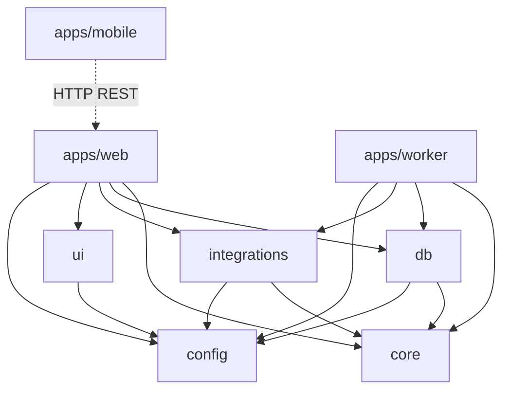
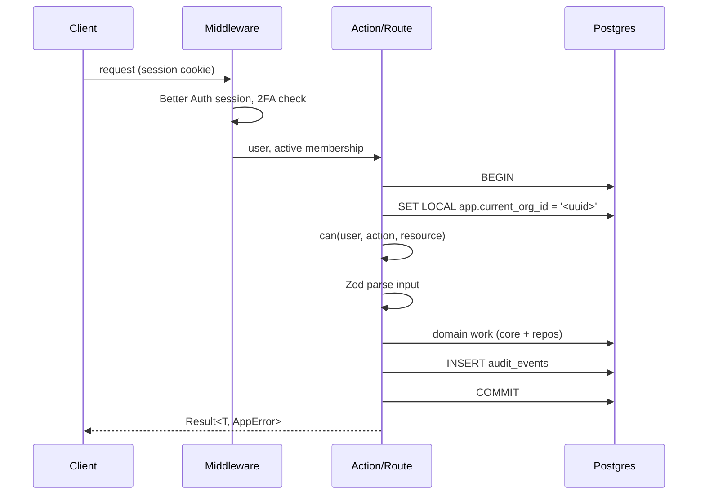
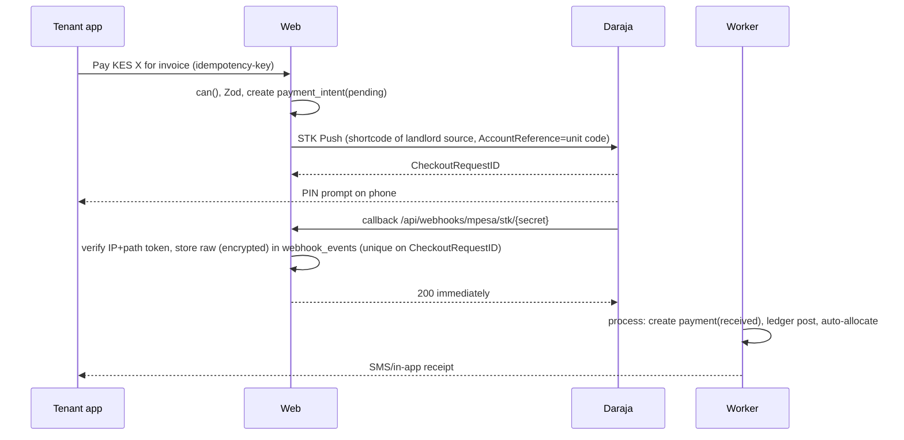
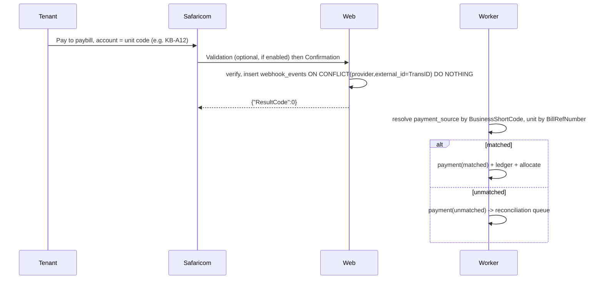
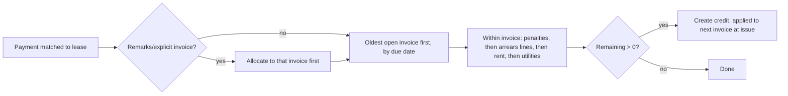

# Kodibox Architecture

Status: living document. Stack decisions are fixed in `CLAUDE.md`; changes need an ADR in `docs/adr/`.

## 1. Goals and quality attributes

| Attribute | Target |
|---|---|
| Correctness of money | Integer minor units, double-entry ledger, append-only, nightly verifier. Zero tolerance for drift. |
| Tenant isolation | RLS on every tenant-scoped table; a bug in app code must not leak across organizations. |
| Security / privacy | DPA 2019 by design: field-level encryption, masked logs, consent, retention (see `SECURITY.md`). |
| Reliability | Webhooks acknowledged < 1 s and processed asynchronously, idempotent. No lost payments. |
| Availability | 99.9% monthly for web and webhook ingress. Worker outage degrades freshness, not correctness. |
| Recoverability | RPO 15 min, RTO 4 h. |
| Auditability | Every money, lease, role, or settings change writes `audit_events`. |
| Operability | One Docker image per app, structured logs, traces, alerts on reconciliation lag. |
| Cost / simplicity | One Postgres, one Redis, one object store. Modular monolith, not microservices. |

Non-goals: holding client funds (ADR 0003), being a payment processor, multi-currency FX (KES only at launch; `currency` column exists for the future).

## 2. Monorepo layout

```
kodibox/
├─ apps/
│  ├─ web/                 Next.js 15 (RSC, Server Actions, route handlers /api/v1, webhooks)
│  │  └─ src/
│  │     ├─ app/           routes (App Router), (public), (dashboard), (tenant-portal), api/
│  │     ├─ features/<feature>/{components,actions,queries,schemas}
│  │     └─ lib/           request context, auth glue, result/AppError, openapi
│  ├─ worker/              BullMQ processors, schedulers, job registry
│  └─ mobile/              Expo / React Native (Phase 3), consumes REST /api/v1
├─ packages/
│  ├─ db/                  Drizzle schema, migrations, RLS policies, `withOrg(tx)` helper, seed
│  ├─ core/                PURE domain logic: ledger/, billing/, allocation/, penalties/, proration/, authz/
│  ├─ integrations/        mpesa/ (Daraja), bank/, sms/ (Africa's Talking), email/, etims/, storage/
│  ├─ ui/                  shared shadcn-based components, tokens
│  └─ config/              env.ts (Zod), tsconfig, eslint, constants (roles, permissions list)
├─ docs/                   ARCHITECTURE, DATA_MODEL, SECURITY, PROJECT_PLAN, adr/, research/
├─ docker/                 Dockerfiles, compose for local dev
├─ turbo.json  pnpm-workspace.yaml  .env.example
```

## 3. Module boundaries and dependency rules



Rules (enforced by ESLint `import/no-restricted-paths` / `dependency-cruiser` in CI):

1. `packages/core` has **no I/O**: no DB, HTTP, filesystem, `Date.now()`, `Math.random()`. Time, ids and config are passed in. It imports only `config` types and Zod. 100% unit-tested.
2. `core` defines **ports** (TypeScript interfaces such as `LedgerRepo`, `Clock`); `db` and `integrations` implement them. Dependencies point inward.
3. `apps/*` never import from each other. `apps/mobile` only talks to the REST API; it may import generated API types.
4. Only `packages/db` imports `drizzle-orm`. Only `packages/integrations` talks to third parties.
5. Feature folders in `apps/web` do not import each other's `components`; share through `packages/ui` or `core`.
6. Anything that mutates money goes through `core/ledger` `post()`; there is no other write path to `ledger_entries` (the DB role for app code has INSERT-only on it).

## 4. Request lifecycle



1. **Auth**: Better Auth resolves the session; owner/manager must have TOTP enabled or are forced to enrol.
2. **Org context**: the active org comes from the session's selected membership (never from client input alone; it is validated against memberships).
3. **RLS**: `withOrg(orgId, fn)` opens a transaction and runs `SELECT set_config('app.current_org_id', $1, true)` (equivalent to `SET LOCAL`). The app connects as a non-owner role without `BYPASSRLS`.
4. **Authz**: `can(user, action, resource)` in `core/authz`: pure function of role, membership scope (property list for managers/caretakers) and resource. Server-side on every action.
5. **Validation**: Zod schema at the boundary; failures return `AppError{code:'VALIDATION'}`.
6. **Action**: orchestrates `core` functions and repos inside the same transaction.
7. **Audit**: `audit_events` row in the same transaction (actor, action, before/after, IP, UA). Commit or nothing.
8. Errors are mapped to `Result<T, AppError>`; raw errors go to Sentry, never the client.

Platform-admin paths use a separate `withPlatformAdmin()` helper that sets `app.bypass_rls_audited = 'on'` (policy permits it only for the `platform_admin` DB role) and always writes an audit event.

## 5. Multi-tenancy model

- **Organization** = the SaaS customer (a landlord, a property-management agency, or a SACCO/caretaker firm). Every tenant-scoped row has `organization_id`.
- **User** is global (one login), linked to organizations via **memberships** (`user_id`, `organization_id`, `role`, optional `property_ids` scope).
- **Roles**: `owner`, `manager`, `accountant`, `caretaker`, `tenant`, `platform_admin`.

| Role | Scope | Summary |
|---|---|---|
| owner | whole org | everything incl. billing, roles, payment sources; 2FA mandatory |
| manager | org or assigned properties | leases, invoices, tenants, maintenance; no role/payment-source changes; 2FA mandatory |
| accountant | org, read + finance write | payments, reconciliation, expenses, reports; no tenant PII beyond need |
| caretaker | assigned properties | meter readings, maintenance, notices, view occupancy; no financial totals |
| tenant | own lease(s) only | statements, pay, requests, notices |
| platform_admin | cross-org, audited | Kodibox staff; support and ops only, time-boxed access with reason |

- A tenant (person) who logs in is a `user` with a `tenant` membership linked to a `tenants` row. One person can rent in several organizations.
- **Landlord-on-behalf (agencies)**: an agency org manages properties for several landlords. `landlords` rows (within the agency org) own `properties`. Each landlord can have its own `payment_sources`, statements, and remittance reports. Landlords may optionally be invited as a read-only `owner`-lite membership scoped to their `landlord_id` (Phase 2). Isolation between landlords inside one agency is by app-level `can()` scope, not RLS; isolation between agencies is RLS.

## 6. Payment flows

Kodibox never receives funds. Money lands in the landlord's paybill/till/bank account; Kodibox observes and reconciles (ADR 0003).

### 6.1 STK Push initiated by tenant


A missed callback is recovered by a delayed `stk-status-poll` job calling Transaction Status Query.

### 6.2 C2B paybill (account number = unit code)


Unit codes are unique per org, short, case/space/hyphen-normalised on match. Multi-tenant paybills (agency using one shortcode) resolve org via `payment_sources.shortcode`.

### 6.3 Bank callback

Banks that offer webhooks/statement APIs post to `/api/webhooks/bank/{provider}/{secret}`; others use scheduled statement pulls or CSV/MT940 import (`bank-statement-import` job). All normalise into `webhook_events` then the same `payment` pipeline, with reference matching on narrative (unit code, lease number).

### 6.4 Manual cash / cheque entry

Manager/accountant/caretaker (if permitted) records a payment with method, reference, received date, and optional receipt photo. Creates `payment(source='manual')`, requires a unique reference per method (duplicate warning), is audited, and can be reversed only by a reversing ledger transaction. Cheques start `pending_clearance` and post to ledger only on `cleared`.

### 6.5 Auto-allocation and overpayment


Allocation order is configurable per org (default: oldest due first; line priority rent -> utilities -> other charges -> penalties last, matching the ledger-money skill). Pure function `allocate(payment, openInvoices, policy)` in `core/allocation`; it returns `Allocation[]` and a residual that becomes a `credits` row. Ledger postings are described in DATA_MODEL.md.

## 7. Reconciliation queue

Unmatched payments (unknown unit code, shortcode mismatch, duplicate-looking amounts) land in `payments.status = 'unmatched'`. The queue UI shows payer name (masked), MSISDN (masked), amount, reference, age. Actions: assign to unit/lease (re-runs allocation), split across leases, mark as non-rent income, refund-outside-system (note only), or reject with reason. Aging alerts at 24 h and 72 h. A daily `reconcile-sweep` job retries auto-match using fuzzy reference rules and the payer's phone history.

## 8. Billing engine

Pure logic in `packages/core/billing`; scheduling in the worker.

- **Invoice run**: monthly per lease on `billing_day` (default 1st, generated 5 days ahead if org opts in). Idempotency key `invoice:{lease_id}:{period_start}`; unique constraint prevents duplicates.
- **Lines**: rent (from lease terms at that date), recurring `lease_charges` (garbage, security, service charge, parking), metered utilities from approved `meter_readings`, carried credits applied as allocations, and arrears shown as informational balance (arrears are not re-billed).
- **Metered utilities**: consumption = reading - previous reading; unit price or tiered tariff; estimated reading allowed with flag; disputed readings block that line only.
- **Penalties**: `penalty_rule` per org/property (flat or % of overdue rent, one-off or per-period, cap). Applied by `penalty-run` after `due_date + grace_days`; idempotent per `invoice_id + rule_id + period`. Waivable with reason (reversing entry, audited).
- **Deposits**: held as a **liability** (`deposits_held`), not income; refunds computed at move-out minus documented deductions (see DATA_MODEL).
- **Pro-rating**: move-in/out mid-month charges `rent * days_occupied / days_in_month` using integer math with largest-remainder rounding; rule configurable (daily vs 30-day basis).
- **Corrections**: never edit an issued invoice; issue credit note (reversal) and re-issue.

## 9. Notifications

Channels: SMS (Africa's Talking, primary), email (Resend/SES), in-app (Postgres + SSE), WhatsApp (later, via Business API, template-based).
Flow: domain event -> `notifications` row (queued) -> `notify` job -> channel adapter -> delivery webhook updates status. Each send checks `consents`/lawful basis and quiet hours (no SMS 21:00-07:00 EAT unless transactional-urgent). Transactional (receipts, invoices) rely on contract basis; reminders on legitimate interest with opt-out; marketing requires opt-in and STOP handling. Templates live in `message_templates` (per org, per locale en/sw) with variable whitelist. Cost caps per org to stop runaway SMS.

## 10. Background jobs

| Job | Schedule (Africa/Nairobi) | Idempotency key |
|---|---|---|
| `webhook-process` | on enqueue | `webhook_events.id` |
| `invoice-run` | daily 02:00, handles leases due | `invoice:{lease}:{period}` |
| `penalty-run` | daily 03:00 | `penalty:{invoice}:{rule}:{period}` |
| `reminder-run` | daily 09:00 (pre-due, due, overdue) | `rem:{invoice}:{stage}` |
| `reconcile-sweep` | hourly | `recon:{payment}:{attempt-hour}` |
| `stk-status-poll` | +60 s, +5 min after STK | `stk:{checkout_request_id}` |
| `bank-statement-import` | every 30 min per source | `bank:{source}:{txn_ref}` |
| `ledger-verify` | nightly 01:00 | `verify:{org}:{date}` |
| `notify` | on enqueue | `notification.id` |
| `webhook-retry` | every 5 min (exponential, max 24 h) | `webhook_events.id:{attempt}` |
| `retention-purge` | weekly Sun 04:00 | `retention:{table}:{week}` |
| `dsr-export` | on request | `dsr.id` |
| `backup-verify` | weekly | `backup:{date}` |

Rules: all handlers must be safe to run twice; job ids are the idempotency key (BullMQ `jobId`); DB unique constraints are the real guard. Failed jobs go to a DLQ queue with alerting.

## 11. File storage

S3-compatible, private buckets only (`kodibox-docs-{env}`). Keys: `org/{org_id}/{kind}/{uuid}`. Upload via short-lived presigned PUT after server validates type/size; download via presigned GET (<= 5 min) issued after `can()` check. ID scans are encrypted client-side envelope (SSE-KMS or app-level AES-GCM) and virus-scanned (ClamAV job) before availability. `documents` rows hold metadata, hash, retention date. No public ACLs; bucket policy denies non-TLS.

## 12. API for mobile and integrations

**Decision: REST route handlers under `/api/v1` with an OpenAPI 3.1 document generated from the Zod schemas** (`zod-to-openapi`), not tRPC.

Justification: (1) Expo clients and future third parties (accountants, landlord ERPs) need a language-agnostic, versioned contract; tRPC couples to TypeScript and to our monorepo versions of the client. (2) Mobile app releases lag the server, so explicit versioning and additive evolution matter. (3) Zod stays the single source of truth for web forms, actions and API; generated typed clients (`openapi-typescript`) give mobile type safety. (4) Standard tooling for rate limiting, caching, and WAF. Web itself uses Server Actions and RSC directly (no HTTP hop); route handlers and actions share the same `features/*/actions` core functions. Auth for mobile: Better Auth bearer session tokens in secure storage with refresh rotation.

## 13. Observability

- Logs: structured JSON via pino, OpenTelemetry exporter; redaction list for phone, ID, PIN, tokens, payload bodies. Correlation id per request and per job.
- Traces: OTel on web, worker, DB, outbound HTTP.
- Errors: Sentry with PII scrubbing (`beforeSend`).
- Metrics and alerts: webhook latency, queue depth/age, unmatched payments age, ledger-verify failures (page), STK success rate, SMS delivery rate, DB replication lag.
- Health: `/healthz` (liveness), `/readyz` (DB + Redis).

## 14. Environments

| Env | Purpose | Data |
|---|---|---|
| local | docker compose: Postgres 16, Redis, MinIO, mailpit; Daraja sandbox | seed data only |
| staging | prod-like, Daraja sandbox, Testcontainers-style ephemeral DBs for PRs | synthetic only |
| prod | live | real; access via audited break-glass |

Config via env vars validated by `packages/config/env.ts`; secrets from the platform secret manager.

## 15. Deployment

- Docker images: `web`, `worker`; run migrations as a pre-deploy step (`pnpm db:migrate`, forward-only, expand/contract for zero downtime).
- Stateless web and worker scale horizontally; Redis for BullMQ (persistence AOF on); object storage S3-compatible.
- **Database hosting trade-off**:
  - *Managed Postgres abroad* (e.g. AWS eu-west/af-south-1 Cape Town, Neon/Supabase): best tooling, PITR, read replicas; cross-border transfer under DPA 2019 s.48-50 requires a lawful basis (adequate safeguards/contract with processor DPA, SCCs-style clauses, data subject consent where needed) and possibly registration notes with ODPC. Latency from Nairobi 100-150 ms to Cape Town/Europe.
  - *Kenyan host* (e.g. Safaricom Cloud, Liquid, iXAfrica): simplest data-localisation story, low latency, but thinner managed-DB features; we would run Postgres + Patroni/pgBackRest ourselves.
  - **Default**: managed Postgres in `af-south-1` with a signed DPA and encryption (KMS keys under our control), field-level encryption of identifiers so the host never sees plaintext PII, and documented transfer basis in `legal-compliance-kenya.md`. Revisit if a client or regulator requires in-country residency; the app is host-agnostic.
- CDN/WAF in front of web; webhook ingress paths rate-limited and IP-allowlisted for Safaricom ranges.

## 16. Backup and disaster recovery

- **RPO 15 min**: continuous WAL archiving + PITR (5-minute archive interval), nightly base backup, cross-region copy of backups (encrypted).
- **RTO 4 h**: restore runbook; standby/replica promotion for infra failure; infra defined as code so web/worker redeploy from images.
- Object storage: versioning + cross-region replication. Redis is rebuildable (jobs are re-derivable from DB; webhooks persisted before enqueue).
- Quarterly restore drill; `backup-verify` job restores into a scratch DB and runs `ledger-verify`.
- Because raw webhooks are persisted first, payments received during an outage can be replayed; Safaricom also retries and Transaction Status Query backfills gaps.

## 17. Scalability notes

- Target Year 1: ~500 orgs, ~100k units, ~150k payments/month. A single Postgres primary with proper indexes handles this comfortably.
- Hot paths: webhook insert (single row, unique index), statement reads (use denormalised balances), invoice runs (batched per org, chunks of 500 leases, one transaction per lease).
- Partition `ledger_entries`, `audit_events`, `webhook_events` by month when each exceeds ~50M rows; partition key includes `organization_id` hash only if needed.
- Read replica for reports/exports; heavy reports run as jobs writing to storage.
- Invoice-run spikes on the 1st: per-org concurrency limits and queue priorities (webhooks > notify > invoice-run > reports).
- RLS cost: `organization_id` leading column in all composite indexes; policies use `current_setting` cached per statement.
