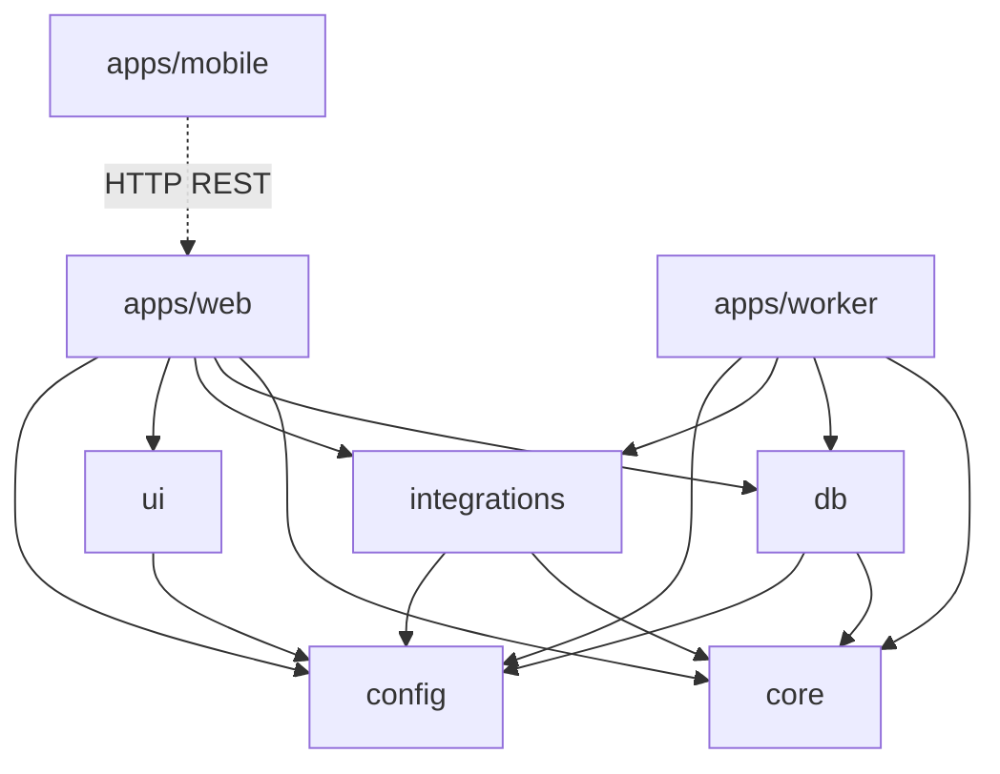
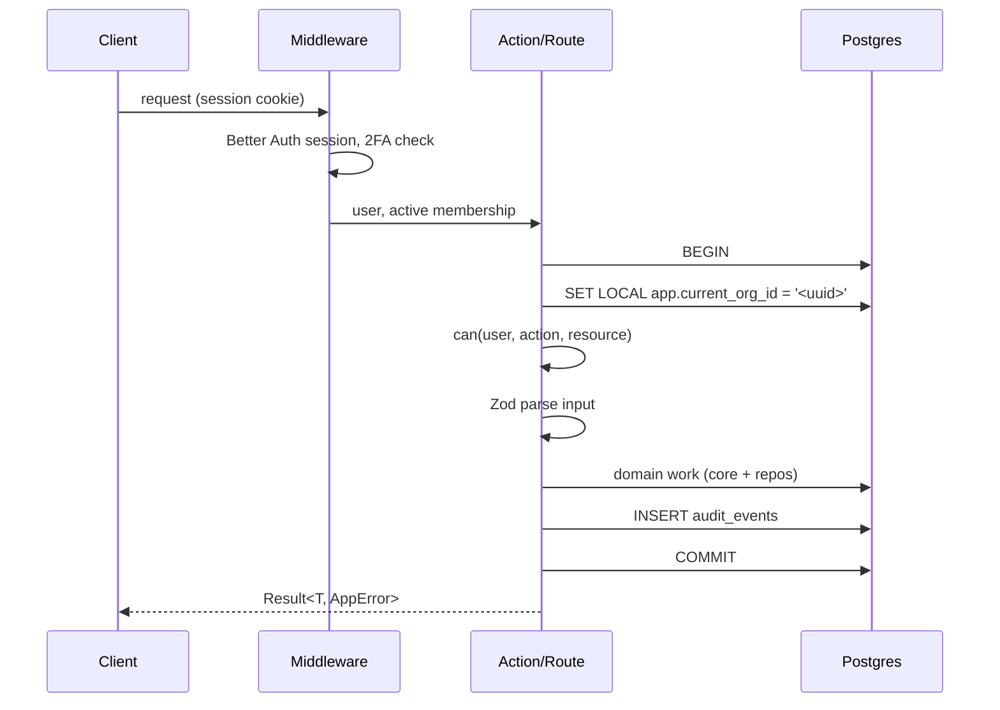
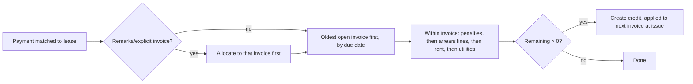
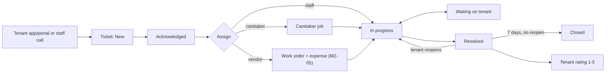

# Kodibox Architecture

Status: living document. Stack decisions are fixed in `CLAUDE.md`; changes need an ADR in `docs/adr/`.

## 1. Goals and quality attributes

| Attribute | Target |
|---|---|
| Correctness of money | Integer minor units, double-entry ledger, append-only, nightly verifier. Zero tolerance for drift. |
| Tenant isolation | RLS on every tenant-scoped table; a bug in app code must not leak across organizations. |
| Security / privacy | DPA 2019 by design: field-level encryption, masked logs, consent, retention (see `SECURITY.md`). |
| Reliability | Statement files and tenant proofs stored before parsing; imports and claims idempotent on (org, payment source, external ref). No lost payment evidence. |
| Availability | 99.9% monthly for web. Worker outage delays reconciliation freshness, not correctness. |
| Recoverability | RPO 15 min, RTO 4 h. |
| Auditability | Every money, lease, role, or settings change writes `audit_events`. |
| Operability | One Docker image per app, structured logs, traces, alerts on reconciliation lag. |
| Cost / simplicity | One Postgres, one Redis, one object store. Modular monolith, not microservices. |

Non-goals: holding client funds (ADR 0003), being a payment processor, initiating or detecting payments through payment rails (ADR 0007), multi-currency FX (KES only at launch; `currency` column exists for the future).

## 2. Monorepo layout

```
kodibox/
├─ apps/
│  ├─ web/                 Next.js 15 (RSC, Server Actions, route handlers /api/v1, statement and proof uploads)
│  │  └─ src/
│  │     ├─ app/           routes (App Router), (public), (dashboard), (tenant-portal), api/
│  │     ├─ features/<feature>/{components,actions,queries,schemas}
│  │     └─ lib/           request context, auth glue, result/AppError, openapi
│  ├─ worker/              BullMQ processors, schedulers, job registry
│  └─ mobile/              Expo SDK 58 / React Native (Phase 3). Prototype today, on demo data; consumes REST /api/v1 once built (section 2.1)
├─ packages/
│  ├─ db/                  Drizzle schema, migrations, RLS policies, `withOrg(tx)` helper, seed
│  ├─ core/                PURE domain logic: ledger/, billing/, allocation/, penalties/, proration/, reconciliation/, authz/
│  ├─ integrations/        payment-sources/ (M-Pesa paybill/till statement, bank CSV/XLSX, SMS proof parser), sms/ (Africa's Talking), email/, etims/, storage/
│  ├─ ui/                  shared components and colour tokens (tokens.ts: light and dark palettes; web CSS variables mirror them, a test keeps them in step)
│  ├─ demo/                shared demo data for the web and mobile prototypes (integer minor units, no I/O)
│  └─ config/              env.ts (Zod), tsconfig, eslint, constants (roles, permissions list)
├─ docs/                   ARCHITECTURE, DATA_MODEL, SECURITY, PROJECT_PLAN, adr/, research/, design/
├─ docker/                 Dockerfiles, compose for local dev
├─ turbo.json  pnpm-workspace.yaml  .env.example
```

### 2.1 Mobile app structure (apps/mobile)
- **Routing:** Expo Router, file-based. Route groups per experience: `(auth)` (welcome, login, roles), `(tenant)`, `(caretaker)` and `(manager)`, each with its own tab layout. Shared screens sit at the top level (`settings.tsx`).
- **Components:** `src/components` holds the shared kit (screen, controls, list rows, copy button, theme toggle, manager UI).
- **Lib:** `src/lib` holds pure helpers (format, phone, OTP, readings, jobs, payment instructions, manager data, payments engine) with Vitest tests next to them.
- **State:** `src/state/demo-state.tsx` is an in-memory demo store (approvals, claims, cash). There is no network or database access in the prototype.
- **Theme:** `src/theme` maps `@kodibox/ui` tokens to light and dark palettes. Fonts: Manrope for text and IBM Plex Mono for amounts and codes (`fonts.ts`).
- **Data:** `@kodibox/demo` supplies the persona and seed data. Money is integer minor units, as on the server.

## 3. Module boundaries and dependency rules



Rules (enforced by ESLint `import/no-restricted-paths` / `dependency-cruiser` in CI):

1. `packages/core` has **no I/O**: no DB, HTTP, filesystem, `Date.now()`, `Math.random()`. Time, ids and config are passed in. It imports only `config` types and Zod. 100% unit-tested.
2. `core` defines **ports** (TypeScript interfaces such as `LedgerRepo`, `Clock`); `db` and `integrations` implement them. Dependencies point inward.
3. `apps/*` never import from each other. `apps/mobile` only talks to the REST API; it may import generated API types.
4. Only `packages/db` imports `drizzle-orm`. Only `packages/integrations` talks to third parties.
5. Feature folders in `apps/web` do not import each other's `components`; share through `packages/ui` or `core`.
6. Anything that mutates money goes through `core/ledger` `post()`; there is no other write path to `ledger_entries` (the DB role for app code has INSERT-only on it).

## 4. Request lifecycle



1. **Auth**: Better Auth resolves the session; owner/manager must have TOTP enabled or are forced to enrol.
2. **Org context**: the active org comes from the session's selected membership (never from client input alone; it is validated against memberships).
3. **RLS**: `withOrg(orgId, fn)` opens a transaction and runs `SELECT set_config('app.current_org_id', $1, true)` (equivalent to `SET LOCAL`). The app connects as a non-owner role without `BYPASSRLS`.
4. **Authz**: `can(user, action, resource)` in `core/authz`: pure function of role, membership scope (property list for managers/caretakers) and resource. Server-side on every action.
5. **Validation**: Zod schema at the boundary; failures return `AppError{code:'VALIDATION'}`.
6. **Action**: orchestrates `core` functions and repos inside the same transaction.
7. **Audit**: `audit_events` row in the same transaction (actor, action, before/after, IP, UA). Commit or nothing.
8. Errors are mapped to `Result<T, AppError>`; raw errors go to Sentry, never the client.

Platform-admin paths use a separate `withPlatformAdmin()` helper that sets `app.bypass_rls_audited = 'on'` (policy permits it only for the `platform_admin` DB role) and always writes an audit event.

## 5. Multi-tenancy model

- **Organization** = the SaaS customer (a landlord, a property-management agency, or a SACCO/caretaker firm). Every tenant-scoped row has `organization_id`.
- **User** is global (one login), linked to organizations via **memberships** (`user_id`, `organization_id`, `role`, optional `property_ids` scope).
- **Roles**: `owner`, `manager`, `accountant`, `caretaker`, `tenant`, `landlord_viewer`, `platform_admin` (`platform_admin` is not a membership role; see below).

| Role | Scope | Summary |
|---|---|---|
| owner | whole org | everything incl. billing, roles, payment sources; 2FA mandatory |
| manager | org or assigned properties | leases, invoices, tenants, maintenance; no role/payment-source changes; 2FA mandatory |
| accountant | org, read + finance write | payments, reconciliation, expenses, reports; no tenant PII beyond need |
| caretaker | assigned properties | meter readings, maintenance, notices, view occupancy; no financial totals |
| tenant | own lease(s) only | statements, pay, requests, notices |
| landlord_viewer | agency clients only, scoped to `landlord_id` | read-only portal: statements and remittances |
| platform_admin | cross-org, audited | Kodibox staff; support and ops only, time-boxed access with reason |

- A tenant (person) who logs in is a `user` with a `tenant` membership linked to a `tenants` row. One person can rent in several organizations.
- **Landlord-on-behalf (agencies)**: an agency org manages properties for several landlords. `landlords` rows (within the agency org) own `properties`. Each landlord can have its own `payment_sources`, statements, and remittance reports. Landlords of an agency may optionally be invited as a read-only `landlord_viewer` membership scoped to their `landlord_id` (Phase 2). An independent landlord is not an agency client: they are the Owner of their own Organization and need no `landlord_viewer` membership (DATA_MODEL, memberships). Isolation between landlords inside one agency is by app-level `can()` scope, not RLS; isolation between agencies is RLS.

## 6. Payment evidence and reconciliation

Kodibox never receives funds and never initiates or detects payments (ADR 0003, ADR 0007). Tenants pay outside Kodibox into the landlord's own paybill, till or bank account. Kodibox reconciles the evidence that the landlord or tenant brings in: statement imports, tenant payment claims and manual entries. All three go through the same pipeline.

### 6.1 Payment instructions

Each property or landlord has `payment_sources` (`mpesa_paybill`, `mpesa_till` or `bank`) with display details and an account reference rule. Tenants see the paybill or till number, the exact account reference to use (their unit code), and bank details, each with a copy button. Invoices, reminders, receipts and the tenant portal repeat the same instructions. The account reference is the main matching key, so it must be correct everywhere. No payment-rail credentials are stored.

### 6.2 Statement import, tenant claims and manual entries

```mermaid
sequenceDiagram
  participant L as Landlord or manager
  participant T as Tenant
  participant W as Web
  participant Q as Worker
  L->>W: Upload M-Pesa or bank statement (CSV/XLSX)
  W->>W: can(payments:import), type/size checks, store file encrypted, enqueue
  W-->>L: Import queued, preview when parsed
  Q->>Q: statement-parse: scan, parse via PaymentSource, normalise to payment_records
  Q->>Q: dedupe on (org, payment_source, external_ref); re-import is a no-op
  T->>W: Paste M-Pesa SMS or upload slip (claim)
  W->>Q: store claim (pending_verification)
  Q->>Q: reconcile-match: merge with statement line if one exists
  Q->>Q: match, auto-allocate above threshold, else unmatched queue
  L->>W: Approve or reject a claim, or confirm a queued match
  W->>W: can(), audit, post via ledger
```

Steps:

1. **Parse**: the `statement-parse` job reads the stored file and applies a known layout (M-Pesa paybill/till export, bank CSV/XLSX) or a saved column-mapping template for the org and payment source. Parse errors are reported per row; the import is previewed before anything is committed.
2. **Normalise**: each line becomes a `payment_records` row (`source`, `external_ref`, `amount_minor`, `currency`, `paid_at`, payer name and hashed payer phone, `account_ref`, encrypted raw line).
3. **Dedupe**: unique on (organization_id, payment_source_id, external_ref). Without a reference, an amount and date fingerprint flags a suspected duplicate for review. A tenant claim and the statement line for the same payment merge into one record.
4. **Match**: `reconcile-match` scores each record. Account reference (unit code or lease reference) carries the most weight, then a known payer phone or name for that lease, then amount close to the open balance within a date window.
5. **Allocate**: above the auto-match threshold, the record is allocated oldest-first through the ledger (6.4). Below it, the record goes to the unmatched queue (section 7).
6. **Tenant claims** (paste an M-Pesa SMS or upload a bank slip or receipt photo) are parsed for transaction code, amount, date and account reference, then stored as `payment_claims` with status `pending_verification`. A claim changes nothing in the ledger until a statement line confirms it or a manager approves it. Approval and rejection are audited.
7. **Manual entries** (cash, cheque, deposit) are recorded with method, reference, received date and optional receipt photo. A caretaker's cash entry needs maker-checker approval. Duplicate references per payment source trigger a warning. Cheques stay `pending_verification` and post to the ledger only when cleared.

Every step writes `audit_events` (actor, IP, user agent, file hash, counts).

### 6.3 Parser interface

Statement parsers and any future feed implement one `PaymentSource` interface in `packages/integrations/payment-sources`. Each parser turns its input into `PaymentRecord`s and never touches the database. Parsers available at launch: M-Pesa paybill/till statement, bank CSV/XLSX and column-mapping template, tenant SMS proof text. OFX is a later addition. A direct rail feed may be added only through a new ADR, as an optional per-org plug-in that produces the same `PaymentRecord`s.

### 6.4 Auto-allocation and overpayment

### 6.4 Auto-allocation and overpayment


Allocation order is configurable per org (default: oldest due first; line priority rent -> utilities -> other charges -> penalties last, matching the ledger-money skill). Pure function `allocate(payment, openInvoices, policy)` in `core/allocation`; it returns `Allocation[]` and a residual that becomes a `credits` row. Ledger postings are described in DATA_MODEL.md.

### 6.5 Reconciliation code as built
The reconciliation logic is pure (no I/O, no clock) and lives in `packages/core/src/reconciliation`, with one module per step:

| Step | Module | Exports (main) |
|---|---|---|
| Types and records | `types.ts`, `records.ts` | `PaymentRecord`, `PaymentSource`, phone hasher types; `toPaymentRecord`, `toPaymentRecordWithRaw` |
| CSV | `csv.ts` | `parseCsv` with size and row limits |
| Parse | `parsers.ts` | `parseMpesaStatementCsv`, `parseBankCsv` (with a column mapping), `parseMpesaSms` (pasted claim text). Row errors are per row |
| Normalise | `normalize.ts` | `normaliseExternalRef`, `normaliseAccountRef`, `normalisePhone`, `hashedPhone`, `maskPhone`, `parseAmountMinor`, `nairobiToUtcIso`, `withinPaymentWindow`, `neutraliseForSpreadsheet` (no formula execution) |
| Deduplicate | `dedupe.ts` | `dedupeKey`, `fingerprint`, `dedupe`: duplicates, claim merges, conflicts, possible duplicates |
| Match | `match.ts` | `match`: scored candidates from account reference, payer and amount window |
| Allocate | `allocate.ts` | `allocate`: oldest-first allocation, with any residual for a credit |
| Orchestrate | `reconcile.ts` | `reconcile`: matched and unmatched payments, allocations and claim reviews |
| Test helpers | `testing.ts`, `__fixtures__/` | `createTestPhoneHasher` (exported as `@kodibox/core/testing`); synthetic statement and SMS fixtures |

Tests: `engine`, `parsers`, `review`, and the security review rounds (`round3`, `round5`, `security`). The branch reports 160 tests for this module (see `docs/PROGRESS.md`).

Still to build: the worker that stores and parses files, the database writes, ledger posting through `core/ledger`, the audit events, and the unmatched queue persistence (M1-07 to M1-09). The web prototype drives its screens from `apps/web/src/demo` (`recon.ts`, with `recon.test.ts`) on the shared `packages/demo` data.

Open point: ADR 0007 places the statement parsers in `packages/integrations/payment-sources`. The pure parsing code currently sits in `packages/core/src/reconciliation`. Keep the parsing logic pure in core, and move only the file and I/O adapters into `integrations`, or record the change in an ADR.

## 7. Reconciliation queue

The unmatched queue holds `payment_records` with status `unmatched` (unknown account reference, unknown payer, amount far from any open balance, suspected duplicate) and `payment_claims` with status `pending_verification`. The queue UI shows payer name (masked), payer phone (masked), amount, reference, source, age. Actions:

- **Confirm** a suggested match (one tap), or assign to a unit/lease (re-runs allocation).
- **Split** across leases or invoices.
- **Reassign** to another lease; the original match is reversed through the ledger, never edited.
- **Ignore** as non-rent income, with a note.
- **Approve or reject** a claim, with a reason on rejection.

Every action writes `audit_events`. Aging alerts at 24 h and 72 h. An hourly `reconcile-sweep` job re-runs matching for queued records and claims, using fuzzy reference rules and the payer's phone history.

## 8. Billing engine

Pure logic in `packages/core/billing`; scheduling in the worker.

- **Invoice run**: monthly per lease on `billing_day` (default 1st, generated 5 days ahead if org opts in). Idempotency key `invoice:{lease_id}:{period_start}`; unique constraint prevents duplicates.
- **Lines**: rent (from lease terms at that date), recurring `lease_charges` (garbage, security, service charge, parking), metered utilities from approved `meter_readings`, carried credits applied as allocations, and arrears shown as informational balance (arrears are not re-billed).
- **Metered utilities**: consumption = reading - previous reading; unit price or tiered tariff; estimated reading allowed with flag; disputed readings block that line only.
- **Penalties**: `penalty_rule` per org/property (flat or % of overdue rent, one-off or per-period, cap). Applied by `penalty-run` after `due_date + grace_days`; idempotent per `invoice_id + rule_id + period`. Waivable with reason (reversing entry, audited). Skipped for tenants with a pending payment claim inside the grace window.
- **Deposits**: held as a **liability** (`deposits_held`), not income; refunds computed at move-out minus documented deductions (see DATA_MODEL).
- **Pro-rating**: move-in/out mid-month charges `rent * days_occupied / days_in_month` using integer math with largest-remainder rounding; rule configurable (daily vs 30-day basis).
- **Corrections**: never edit an issued invoice; issue credit note (reversal) and re-issue.

### 8.1 Tickets

Tenant complaints and repair requests (see `DATA_MODEL.md` `tickets`). Tickets are raised from the tenant app/portal or logged by staff from a call; SMS `HELP` and WhatsApp are later channels.



- **SLAs** per org: acknowledge within 24 h (emergency 1 h); resolve targets per urgency. A breach sets `sla_breached_at`, escalates to the Owner and flags the dashboard.
- **Routing**: complaints about a manager or caretaker go straight to the Owner, not the accused person.
- **Billing queries** link to the invoice or payment; a correction is a credit note or reversal, never a deletion.
- **Thread**: public replies notify the tenant per channel preference; internal notes never leave staff views.
- **Notification events**: `ticket.created`, `ticket.acknowledged`, `ticket.status_changed`, `ticket.reply` (tenant), `ticket.sla_breached` (Owner), `ticket.resolved` (tenant, rating prompt).
- **Jobs**: `tickets.sla-check` every 5 min; `tickets.auto-close` daily (moves Resolved to Closed after 7 days unless reopened). See section 10.

## 9. Notifications

Channels: SMS (Africa's Talking, primary), email (Resend/SES), in-app (Postgres + SSE), WhatsApp (later, via Business API, template-based).
Flow: domain event -> `notifications` row (queued) -> `notify` job -> channel adapter -> delivery webhook updates status. Each send checks `consents`/lawful basis and quiet hours (no SMS 21:00-07:00 EAT unless transactional-urgent). Transactional (receipts, invoices) rely on contract basis; reminders on legitimate interest with opt-out; marketing requires opt-in and STOP handling. Templates live in `message_templates` (per org, per locale en/sw) with variable whitelist. Cost caps per org to stop runaway SMS.

## 10. Background jobs

| Job | Schedule (Africa/Nairobi) | Idempotency key |
|---|---|---|
| `statement-parse` | on upload (scan, then parse, then preview) | `statement:{import_id}` |
| `reconcile-match` | on record or claim ingest, and after a statement commit | `match:{payment_record}:{attempt-hour}` |
| `invoice-run` | daily 02:00, handles leases due | `invoice:{lease}:{period}` |
| `penalty-run` | daily 03:00 | `penalty:{invoice}:{rule}:{period}` |
| `reminder-run` | daily 09:00 (pre-due, due, overdue) | `rem:{invoice}:{stage}` |
| `import-reminder` | daily or weekly per org setting, 09:00 | `import-rem:{org}:{date}` (includes open claim count) |
| `reconcile-sweep` | hourly | `recon:{payment}:{attempt-hour}` |
| `ledger-verify` | nightly 01:00 | `verify:{org}:{date}` |
| `notify` | on enqueue | `notification.id` |
| `retention-purge` | weekly Sun 04:00 | `retention:{table}:{week}` |
| `dsr-export` | on request | `dsr.id` |
| `tickets.sla-check` | every 5 min | `sla:{ticket}:{ack\|resolve}` |
| `tickets.auto-close` | daily | `autoclose:{ticket}:{resolved_at}` |
| `backup-verify` | weekly | `backup:{date}` |

Rules: all handlers must be safe to run twice; job ids are the idempotency key (BullMQ `jobId`); DB unique constraints are the real guard. Failed jobs go to a DLQ queue with alerting.

## 11. File storage

S3-compatible, private buckets only (`kodibox-docs-{env}`). Keys: `org/{org_id}/{kind}/{uuid}`. Upload via short-lived presigned PUT after server validates type/size; download via presigned GET (<= 5 min) issued after `can()` check. ID scans are encrypted client-side envelope (SSE-KMS or app-level AES-GCM) and virus-scanned (ClamAV job) before availability. `documents` rows hold metadata, hash, retention date. No public ACLs; bucket policy denies non-TLS.

## 12. API for mobile and integrations

**Decision: REST route handlers under `/api/v1` with an OpenAPI 3.1 document generated from the Zod schemas** (`zod-to-openapi`), not tRPC.

Justification: (1) Expo clients and future third parties (accountants, landlord ERPs) need a language-agnostic, versioned contract; tRPC couples to TypeScript and to our monorepo versions of the client. (2) Mobile app releases lag the server, so explicit versioning and additive evolution matter. (3) Zod stays the single source of truth for web forms, actions and API; generated typed clients (`openapi-typescript`) give mobile type safety. (4) Standard tooling for rate limiting, caching, and WAF. Web itself uses Server Actions and RSC directly (no HTTP hop); route handlers and actions share the same `features/*/actions` core functions. Auth for mobile: Better Auth bearer session tokens in secure storage with refresh rotation.

## 13. Observability

- Logs: structured JSON via pino, OpenTelemetry exporter; redaction list for phone, ID, PIN, tokens, payload bodies. Correlation id per request and per job.
- Traces: OTel on web, worker, DB, outbound HTTP.
- Errors: Sentry with PII scrubbing (`beforeSend`).
- Metrics and alerts: statement parse failures and row error rate, queue depth/age, unmatched records and pending claims age, auto-match rate, ledger-verify failures (page), SMS delivery rate, DB replication lag.
- Health: `/healthz` (liveness), `/readyz` (DB + Redis).

## 14. Environments

| Env | Purpose | Data |
|---|---|---|
| local | docker compose: Postgres 16, Redis, MinIO, mailpit; synthetic statement fixtures | seed data only |
| staging | prod-like, Testcontainers-style ephemeral DBs for PRs, synthetic statement fixtures | synthetic only |
| prod | live | real; access via audited break-glass |

Config via env vars validated by `packages/config/env.ts`; secrets from the platform secret manager.

## 15. Deployment

- Docker images: `web`, `worker`; run migrations as a pre-deploy step (`pnpm db:migrate`, forward-only, expand/contract for zero downtime).
- Stateless web and worker scale horizontally; Redis for BullMQ (persistence AOF on); object storage S3-compatible.
- **Database hosting trade-off**:
  - *Managed Postgres abroad* (e.g. AWS eu-west/af-south-1 Cape Town, Neon/Supabase): best tooling, PITR, read replicas; cross-border transfer under DPA 2019 s.48-50 requires a lawful basis (adequate safeguards/contract with processor DPA, SCCs-style clauses, data subject consent where needed) and possibly registration notes with ODPC. Latency from Nairobi 100-150 ms to Cape Town/Europe.
  - *Kenyan host* (e.g. Safaricom Cloud, Liquid, iXAfrica): simplest data-localisation story, low latency, but thinner managed-DB features; we would run Postgres + Patroni/pgBackRest ourselves.
  - **Default**: managed Postgres in `af-south-1` with a signed DPA and encryption (KMS keys under our control), field-level encryption of identifiers so the host never sees plaintext PII, and documented transfer basis in `legal-compliance-kenya.md`. Revisit if a client or regulator requires in-country residency; the app is host-agnostic.
- CDN/WAF in front of web; statement and claim upload paths rate-limited and size-capped (see `SECURITY.md` section 7).

## 16. Backup and disaster recovery

- **RPO 15 min**: continuous WAL archiving + PITR (5-minute archive interval), nightly base backup, cross-region copy of backups (encrypted).
- **RTO 4 h**: restore runbook; standby/replica promotion for infra failure; infra defined as code so web/worker redeploy from images.
- Object storage: versioning + cross-region replication. Redis is rebuildable (jobs are re-derivable from DB; uploaded statement files are persisted before enqueue).
- Quarterly restore drill; `backup-verify` job restores into a scratch DB and runs `ledger-verify`.
- Because statement files and claim evidence are persisted first, an import or claim lost to a worker outage can be re-parsed and re-matched from storage.

## 17. Scalability notes

- Target Year 1: ~500 orgs, ~100k units, ~150k payments/month. A single Postgres primary with proper indexes handles this comfortably.
- Hot paths: payment record insert (unique index on source and external ref), statement reads (use denormalised balances), invoice runs (batched per org, chunks of 500 leases, one transaction per lease).
- Partition `ledger_entries`, `audit_events`, `payment_records` by month when each exceeds ~50M rows; partition key includes `organization_id` hash only if needed.
- Read replica for reports/exports; heavy reports run as jobs writing to storage.
- Invoice-run spikes on the 1st: per-org concurrency limits and queue priorities (parse/match > notify > invoice-run > reports).
- RLS cost: `organization_id` leading column in all composite indexes; policies use `current_setting` cached per statement.
