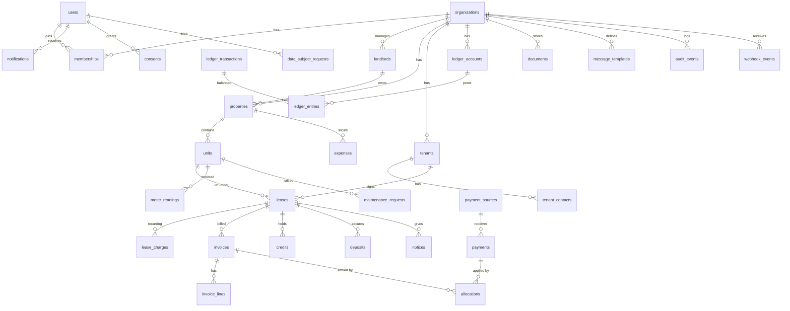

# Kodibox Data Model

PostgreSQL 16, Drizzle ORM. Conventions apply to every table unless stated.

## 0. Conventions

- `id uuid PK default uuidv7()` (time-ordered). `created_at`, `updated_at timestamptz not null default now()`.
- Tenant-scoped tables carry `organization_id uuid not null references organizations(id)` and an RLS policy: `USING (organization_id = current_setting('app.current_org_id')::uuid) WITH CHECK (same)`. Added in the same migration as the table. Composite indexes start with `organization_id`.
- Money: `*_minor bigint` (KES cents) + `currency char(3) default 'KES'`. Never float. `CHECK (amount_minor >= 0)` unless noted.
- Dates: billing periods are `date`; instants are `timestamptz` (UTC).
- Phones: E.164. **[ENC]** = application-layer envelope encryption (AES-256-GCM, per-org DEK wrapped by KMS KEK) stored as `bytea`, with a `*_hash` column (HMAC-SHA256, pepper in KMS) for exact-match lookup. **[PII]** = personal data, masked in UI/logs, subject to retention. Soft delete via `deleted_at` only where noted; money tables never delete.
- Enums are Postgres enums or `text` + CHECK (prefer CHECK for easier migrations).

## 1. ERD

## 2. Tables

### organizations (global; RLS on `id = current_org`)
`name text`, `type text CHECK in (landlord, agency)`, `kra_pin` [ENC][PII-business], `slug text unique`, `plan text`, `settings jsonb` (grace days, allocation policy, penalty defaults, billing day), `timezone default 'Africa/Nairobi'`, `status (active|suspended|closed)`, `data_region text`, `dpo_contact text`. Index: unique(slug). Registered with ODPC flag `odpc_registration_no text`.

### users (global; no org_id; RLS: self-row or via membership join; platform_admin audited)
`email citext unique null`, `phone_e164` [ENC][PII] + `phone_hash unique`, `password_hash` (Better Auth), `name` [PII], `locale (en|sw)`, `totp_enabled bool`, `last_login_at`, `status`, `deleted_at`. Better Auth tables (`sessions`, `accounts`, `verifications`) live alongside; sessions store hashed tokens. CHECK (email is not null or phone_hash is not null).

### memberships
`user_id`, `organization_id`, `role CHECK in (owner, manager, accountant, caretaker, tenant, platform_admin)`, `property_ids uuid[] null` (null = all), `landlord_id null`, `tenant_id null` (set for role=tenant), `invited_by`, `status (invited|active|revoked)`. Unique(user_id, organization_id, role). Index (organization_id, role). Constraint: role=tenant requires tenant_id. Role changes audited. RLS: org-scoped; users may read their own memberships through a separate `SECURITY DEFINER` function used at login.

### landlords
Property owners when the org is an agency (a landlord org has exactly one default landlord row). `organization_id`, `display_name`, `kra_pin` [ENC], `phone` [ENC][PII], `email` [PII], `remittance_account jsonb` [ENC], `commission_bps int` (management fee in basis points), `status`. Unique(organization_id, display_name).

### properties
`organization_id`, `landlord_id`, `name`, `code text` (short, unique per org), `address jsonb` (county, town, estate, street), `geo point null`, `type (apartment|bungalow|commercial|mixed|hostel)`, `payment_source_id null` (default collection account), `settings jsonb`, `deleted_at`. Unique(organization_id, code). Index (organization_id, landlord_id).

### units
`organization_id`, `property_id`, `code text` (**the paybill account number**, e.g. `A12`; globally unique per org via `UNIQUE(organization_id, code_normalized)`), `code_normalized` (upper, no spaces/hyphens, generated), `label`, `floor`, `bedrooms`, `type`, `rent_minor bigint` (list price), `status (vacant|occupied|reserved|maintenance)`, `meter_ids jsonb`. Index (organization_id, property_id, status).

### tenants (the renting person/company)
`organization_id`, `user_id null` (portal login), `kind (individual|company)`, `full_name` [PII], `national_id` [ENC][PII] + `national_id_hash`, `kra_pin` [ENC] (optional, companies), `primary_phone` [ENC][PII] + `phone_hash`, `email` [PII], `dob` [PII] optional, `nationality`, `employer` optional, `status (prospect|active|former)`, `retention_until date`. Index (organization_id, phone_hash), (organization_id, national_id_hash). Collect minimum; ID optional for rent-only use unless org requires lease.

### tenant_contacts
Emergency contact, guarantor, co-tenant, billing contact. `organization_id`, `tenant_id`, `kind`, `name` [PII], `phone` [ENC] + `phone_hash`, `email`, `relationship`, `notify_on_arrears bool default false` (needs consent). Index (organization_id, tenant_id).

### leases
`organization_id`, `unit_id`, `tenant_id`, `lease_no text unique per org`, `start_date date`, `end_date date null`, `rent_minor`, `billing_day smallint 1..28`, `due_day_offset smallint`, `grace_days smallint`, `escalation jsonb null` (e.g. 5% yearly), `deposit_required_minor`, `status (draft|active|notice|ended|terminated)`, `ended_at`, `proration_basis (actual_days|thirty_day)`, `penalty_rule jsonb`, `document_id null`. Constraint: EXCLUDE USING gist (unit_id WITH =, daterange(start_date, coalesce(end_date,'infinity'),'[]') WITH &&) WHERE (status in ('active','notice')) - no overlapping leases. Index (organization_id, unit_id, status), (organization_id, tenant_id).

### lease_charges (recurring)
`organization_id`, `lease_id`, `charge_type (garbage|security|service|parking|water_fixed|other)`, `description`, `amount_minor`, `frequency (monthly|quarterly|annual|once)`, `starts_on`, `ends_on null`, `income_account_id`. Index (organization_id, lease_id).

### meter_readings
`organization_id`, `unit_id`, `lease_id null`, `meter_type (water|electricity)`, `reading_date date`, `reading numeric(12,3)` (physical quantity, not money), `previous_reading numeric(12,3)`, `consumption numeric(12,3) generated`, `unit_price_minor`, `photo_document_id null`, `entered_by`, `status (draft|approved|disputed|billed)`, `invoice_line_id null`. Unique(unit_id, meter_type, reading_date). CHECK(reading >= previous_reading or rollover flag). Index (organization_id, unit_id, reading_date desc).

### invoices
`organization_id`, `lease_id`, `number text` (sequential per org, gap-free allocation via counter table), `period_start date`, `period_end date`, `issue_date`, `due_date`, `status (draft|issued|partially_paid|paid|void)`, `total_minor`, `paid_minor` (denormalised), `balance_minor` (denormalised), `currency`, `ledger_transaction_id`, `etims_status`, `etims_ref`, `void_reason`. Unique(organization_id, number); **Unique(lease_id, period_start, kind)** for idempotent runs. Index (organization_id, lease_id, due_date), partial (organization_id, due_date) WHERE balance_minor > 0.

### invoice_lines
`organization_id`, `invoice_id`, `kind (rent|charge|utility|penalty|deposit|adjustment|credit_applied)`, `description`, `quantity numeric`, `unit_amount_minor`, `amount_minor`, `source_type`, `source_id` (lease_charge, meter_reading, penalty rule), `income_account_id`, `vat_bps int default 0`. Unique(invoice_id, source_type, source_id) where source_id not null. Sum(amount_minor) = invoices.total_minor (checked on issue and in verifier).

### payments
Observed receipts only (money already at landlord's account). `organization_id`, `payment_source_id`, `lease_id null`, `tenant_id null`, `method (mpesa_stk|mpesa_c2b|bank|cash|cheque|other)`, `external_ref text` (TransID/bank ref), `amount_minor`, `received_at timestamptz`, `payer_name` [PII], `payer_msisdn` [ENC][PII] + `payer_hash`, `account_ref text` (BillRefNumber as received), `status (pending_clearance|unmatched|matched|allocated|reversed|rejected)`, `allocated_minor`, `unallocated_minor`, `webhook_event_id null`, `ledger_transaction_id`, `recorded_by null`, `note`. **Unique(organization_id, method, external_ref)** where external_ref not null. Index (organization_id, status, received_at), (organization_id, lease_id).

### payment_sources
Landlord-owned collection accounts. `organization_id`, `landlord_id`, `kind (paybill|till|bank|cash)`, `shortcode text`, `label`, `bank_name`, `account_no` [ENC], `daraja_consumer_key` [ENC], `daraja_consumer_secret` [ENC], `passkey` [ENC], `initiator_credential` [ENC], `callback_token_hash` (secret path token; compared constant-time), `c2b_registered_at`, `status (active|disabled)`, `last_webhook_at`. Secrets are write-only in UI (never read back, only "rotate"). Unique(kind, shortcode) globally enough to route webhooks (where kind in paybill/till); resolution function is `SECURITY DEFINER` and returns only org_id.

### allocations
Link between a payment and an invoice (or line). `organization_id`, `payment_id`, `invoice_id`, `invoice_line_id null`, `amount_minor > 0`, `allocated_at`, `allocated_by (system|user_id)`, `reversed_by_allocation_id null`, `ledger_transaction_id`. Amounts are never updated; a reversal sets `reversed_at` and posts a reversing ledger transaction. Index (organization_id, payment_id), (organization_id, invoice_id). Invariant: sum(allocations per payment) <= payment.amount_minor; sum per invoice <= invoice.total_minor.

### credits
Overpayment or goodwill balances held for a lease. `organization_id`, `lease_id`, `source_payment_id null`, `kind (overpayment|goodwill|refund_pending)`, `amount_minor`, `remaining_minor`, `status (open|consumed|refunded)`. Applied automatically at next invoice issue as allocation(s); `remaining_minor` decremented in the same transaction as the ledger entry. Index (organization_id, lease_id, status).

### deposits
`organization_id`, `lease_id`, `kind (rent|security|water|key)`, `amount_minor`, `received_payment_id`, `status (held|partially_refunded|refunded|forfeited)`, `refund_due_date`, `refunded_minor`, `deductions jsonb` (list of {reason, amount_minor, evidence_document_id}), `settlement_ledger_transaction_id`. Held as a liability (account 2100). Refund workflow requires manager approval; refund paid outside Kodibox (bank/M-Pesa by landlord), then recorded.

### expenses
`organization_id`, `property_id`, `landlord_id`, `category (repairs|utilities|security|management_fee|tax|other)`, `vendor`, `amount_minor`, `incurred_on date`, `paid_on null`, `paid_from_source_id null`, `receipt_document_id`, `maintenance_request_id null`, `ledger_transaction_id`, `status (draft|approved|paid|void)`, `submitted_by`. Index (organization_id, property_id, incurred_on).

### ledger_accounts
Chart of accounts per org. `organization_id`, `code text` (e.g. 1100), `name`, `type (asset|liability|equity|income|expense)`, `normal_side (debit|credit)`, `landlord_id null` (sub-ledger for agencies), `parent_id`, `system_key text null` (e.g. `ar_tenants`, `deposits_held`, `rent_income`, `penalty_income`, `utility_income`, `cash_clearing`, `tenant_credit`, `suspense`), `is_active`. Unique(organization_id, code), unique(organization_id, landlord_id, system_key). Seeded at org creation.

### ledger_transactions
Header of a balanced posting. `organization_id`, `occurred_at timestamptz`, `posted_at default now()`, `kind (invoice|payment|allocation|penalty|deposit_receipt|deposit_refund|expense|reversal|adjustment|writeoff)`, `description`, `source_type`, `source_id`, `reverses_transaction_id null unique`, `idempotency_key text`, `created_by`. **Unique(organization_id, idempotency_key)**. Immutable.

### ledger_entries
`organization_id`, `transaction_id`, `account_id`, `side (debit|credit)`, `amount_minor bigint CHECK > 0`, `lease_id null`, `tenant_id null`, `property_id null`, `landlord_id null` (dimensions for reporting), `currency`, `line_no`. Rules:
- Append-only: privileges `INSERT, SELECT` only for the app role; `BEFORE UPDATE OR DELETE` trigger raises; same trigger on ledger_transactions.
- **Zero-sum**: a `DEFERRABLE INITIALLY DEFERRED` constraint trigger on commit checks, per transaction and currency, `sum(debit) = sum(credit)`; at least 2 entries.
- `core/ledger.post()` also validates before insert (defence in depth).
- Index (organization_id, account_id, transaction_id), (organization_id, lease_id), (transaction_id).

### maintenance_requests
`organization_id`, `property_id`, `unit_id null`, `raised_by_user_id`, `tenant_id null`, `title`, `description`, `category`, `priority (low|normal|urgent)`, `status (open|assigned|in_progress|resolved|closed|rejected)`, `assigned_to_user_id null`, `vendor`, `cost_estimate_minor`, `resolved_at`, `photos uuid[]` (documents). Index (organization_id, status, priority).

### notices
Vacation, entry, rent increase, arrears, eviction-stage notices. `organization_id`, `lease_id`, `kind (vacate_by_tenant|vacate_by_landlord|rent_increase|arrears|entry|general)`, `served_on date`, `effective_on date`, `served_by`, `delivery (in_app|sms|email|physical)`, `document_id`, `status (draft|served|acknowledged|withdrawn)`. Kind/period validated against lease terms (e.g. min notice days) in `core`.

### documents
`organization_id`, `owner_type`, `owner_id` (polymorphic), `kind (lease|id_scan|receipt|photo|notice|statement)`, `storage_key`, `mime`, `size_bytes`, `sha256`, `encrypted bool`, `scan_status (pending|clean|infected)`, `uploaded_by`, `retention_until date`, `deleted_at`. [PII] when kind=id_scan. Index (organization_id, owner_type, owner_id).

### notifications
`organization_id`, `recipient_user_id null`, `recipient_tenant_id null`, `channel (sms|email|in_app|whatsapp)`, `template_key`, `to_address` [ENC][PII], `body_rendered text` (PII redacted at rest after 90 days), `status (queued|sent|delivered|failed|suppressed)`, `provider_msg_id`, `error_code`, `cost_minor`, `purpose (transactional|reminder|marketing)`, `consent_id null`, `scheduled_for`, `sent_at`, `related_type/related_id`. Unique(organization_id, template_key, related_id, channel, stage) for dedupe. Index (organization_id, status, scheduled_for).

### message_templates
`organization_id null` (null = platform default), `key`, `channel`, `locale`, `subject`, `body` (with whitelisted `{{vars}}`), `is_active`, `version`. Unique(organization_id, key, channel, locale, version). Marketing templates must include STOP text (CHECK on purpose).

### consents
`organization_id`, `subject_user_id null`, `subject_tenant_id null`, `purpose (marketing_sms|marketing_email|whatsapp|data_sharing|credit_reporting)`, `lawful_basis (consent|contract|legal_obligation|legitimate_interest)`, `granted bool`, `granted_at`, `withdrawn_at`, `source (web|sms_stop|paper|import)`, `evidence jsonb` (policy version, IP, UA, wording), append-only (new row per change). Index (organization_id, subject_tenant_id, purpose, granted_at desc).

### audit_events
Append-only (same trigger protection). `organization_id null` (null for platform events), `actor_user_id`, `actor_role`, `action text` (e.g. `payment.allocate`), `entity_type`, `entity_id`, `before jsonb`, `after jsonb` (PII fields redacted/masked), `ip inet`, `user_agent`, `request_id`, `at timestamptz`. Partition monthly. Index (organization_id, entity_type, entity_id, at desc). Retention per SECURITY.md.

### webhook_events
Raw inbound, idempotent. Not tenant-scoped at ingest (org unknown yet); `organization_id null` until resolved; RLS permits insert by ingest role, select by org once resolved. `provider (mpesa_c2b|mpesa_stk|bank_x)`, `external_id text` (TransID / CheckoutRequestID), `payload_enc bytea` [ENC] (raw body), `headers_redacted jsonb`, `source_ip inet`, `signature_valid bool`, `status (received|processing|processed|failed|ignored)`, `attempts int`, `next_attempt_at`, `error`, `received_at`, `processed_at`. **Unique(provider, external_id)**; insert uses `ON CONFLICT DO NOTHING` (duplicate delivery returns 200). Index (status, next_attempt_at).

### data_subject_requests
`organization_id`, `requester_user_id null`, `requester_tenant_id null`, `kind (access|rectification|erasure|portability|objection|restriction)`, `status (received|verifying|in_progress|completed|rejected)`, `received_at`, `due_at` (received + 30 days), `identity_verified_at`, `handler_id`, `outcome_note`, `export_document_id null`. Erasure is anonymisation where ledger/tax retention applies (identifiers scrubbed, financial rows retained, 7 years). Index (organization_id, status, due_at).

## 3. Ledger rules

1. Every financial event is a `ledger_transaction` with >= 2 `ledger_entries` where debits = credits per currency. Entries are never updated or deleted.
2. A mistake is corrected by a `reversal` transaction (`reverses_transaction_id`) that posts the mirror entries, then a fresh correct transaction. A transaction can be reversed at most once.
3. Idempotency: every posting carries a deterministic `idempotency_key` (`invoice:{id}`, `payment:{provider}:{ref}`, `alloc:{payment}:{invoice}`), enforced by unique constraint.
4. Normal sides: assets and expenses increase by debit; liabilities, equity and income by credit.
5. Seed accounts per landlord sub-ledger: `1100 Cash/Collections (landlord's account, memo)`, `1200 Tenant Receivables (AR)`, `1900 Suspense (unmatched)`, `2100 Deposits Held`, `2200 Tenant Credits`, `4100 Rent Income`, `4200 Utility Income`, `4300 Penalty Income`, `4400 Other Income`, `5xxx Expenses`, `2300 Owed to Landlord / 4500 Management Fee Income` (agency only).
6. "Cash" accounts are memo reflections of the landlord's own bank/M-Pesa balance; they record what we observed, not funds Kodibox holds (ADR 0003).

### Worked examples (amounts in KES; stored as cents)

**A. Invoice issued: rent 20,000 + water 1,500**
| Account | Dr | Cr |
|---|---|---|
| 1200 AR Tenants (lease L1) | 21,500 | |
| 4100 Rent Income | | 20,000 |
| 4200 Utility Income | | 1,500 |

**B. M-Pesa payment 21,500 received, matched to L1** (`payment:mpesa_c2b:SGL7XYZ1`)
| Account | Dr | Cr |
|---|---|---|
| 1100 Cash/Collections | 21,500 | |
| 1200 AR Tenants (L1) | | 21,500 |
Unmatched version: Dr 1100 / Cr 1900 Suspense; on assignment, reclass Dr 1900 / Cr 1200.

**C. Allocation**: Payment to invoice rows is a sub-ledger link (`allocations`), not a second GL posting when payment already credited AR. For overpayment: payment 25,000 vs invoice 21,500: Dr 1100 25,000; Cr 1200 21,500; Cr 2200 Tenant Credits 3,500 (`credits` row remaining 3,500). When next invoice (21,500) issues and credit applies: Dr 2200 3,500; Cr 1200 3,500.

**D. Penalty 5% of 20,000 rent = 1,000 after grace**
| Account | Dr | Cr |
|---|---|---|
| 1200 AR Tenants (L1) | 1,000 | |
| 4300 Penalty Income | | 1,000 |
Waiver: reversal of the same (Dr 4300 / Cr 1200), reason in audit.

**E. Deposit received 40,000**: Dr 1100 40,000 / Cr 2100 Deposits Held 40,000 (liability, not income).

**F. Deposit refund minus damages (3,000 repairs, 2,000 unpaid water)**
Settlement transaction: Dr 2100 40,000; Cr 4400 Other Income (damages recovered) 3,000; Cr 1200 AR (clears arrears 2,000); Cr 1100 Cash 35,000 (refund paid by landlord from own account, recorded once confirmed). Debits 40,000 = credits 40,000. If damages cost real repairs, a separate expense Dr 5100 / Cr 1100.

**G. Reversal**: Payment SGL7XYZ1 was mis-assigned. Post reversal tx R (`reverses_transaction_id = B`): Dr 1200 21,500 / Cr 1100 21,500, mark allocations `reversed_at`, payment `reversed`; then re-record against correct lease. Original rows untouched.

**H. Credit note for wrongly billed water 1,500**: Dr 4200 1,500 / Cr 1200 1,500 (reversal of the line), invoice re-issued or adjustment line added.

## 4. Balances

Truth is `ledger_entries`. For speed we keep denormalised balances, updated **in the same transaction** as the posting.

- `ledger_balances` (organization_id, account_id, lease_id null, `balance_minor` signed in normal-side terms, `last_entry_id`, `version`). `core/ledger.post()` returns balance deltas; the repo applies `INSERT ... ON CONFLICT DO UPDATE SET balance_minor = balance_minor + delta` inside the posting transaction. Row locks serialise concurrent postings on one lease.
- `invoices.paid_minor/balance_minor`, `payments.allocated_minor/unallocated_minor`, `credits.remaining_minor` are likewise updated atomically with their allocations, with CHECK constraints (`balance_minor = total_minor - paid_minor`, `allocated_minor <= amount_minor`).
- Lease/tenant statements and arrears dashboards read `ledger_balances` and open invoices only (never sum all entries online).
- **Nightly `ledger-verify` job** per org: (1) every transaction sums to zero; (2) recompute balances from `ledger_entries` and compare to `ledger_balances`; (3) recompute invoice paid/balance from `allocations`; (4) ensure AR by lease = sum of open invoice balances minus credits; (5) every payment is fully either allocated, credited, or in suspense. Any mismatch pages on-call, writes an `audit_events` row, and (never auto-fixes silently) produces a repair proposal executed via explicit adjustment transactions. Runs also after restores (`backup-verify`).
- Month-end: `period_closes` snapshot (org, period, balances hash) makes closed periods immutable; late postings go to the current period with `occurred_at` preserved.
